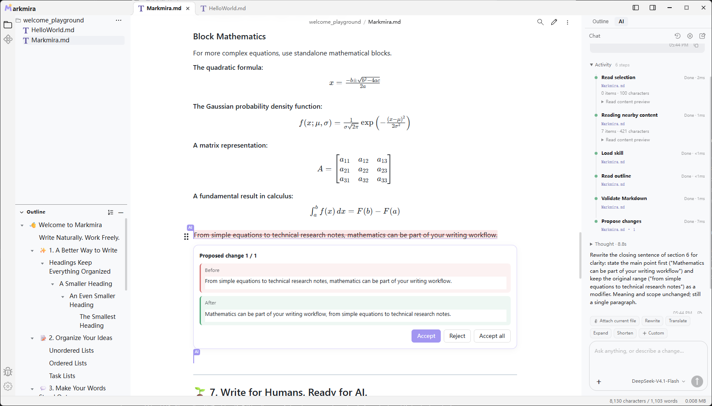
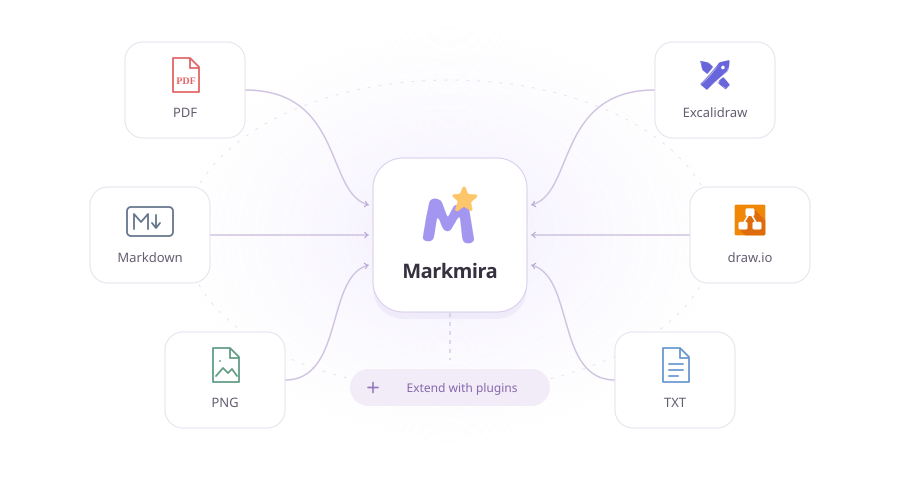

  

<h1 align="center">Markmira</h1>

<strong>Write Naturally. Work Freely.</strong>

A local-first WYSIWYG Markdown workspace for writing, documents, and AI.

  
  
  

  <a href="https://www.markmira.top">Website</a> ·
  <a href="https://github.com/HuayueAI/markmira-releases/releases/latest">Download</a> ·
  <a href="https://www.markmira.top/try-online">Playground</a> ·
  <a href="https://github.com/HuayueAI/markmira-releases/releases">Release notes</a> ·
  <a href="https://github.com/HuayueAI/markmira-releases/issues">Feedback</a>

---

**Markmira is a local-first, WYSIWYG Markdown workspace built for freedom and flexibility.** Write naturally with an intuitive, real-time Markdown editor, work seamlessly with multiple document formats, and enhance your workflow with AI. Choose your own AI providers and synchronization methods, while keeping your files local, portable, and stored in plain Markdown—free from vendor lock-in. Extend your workspace with plugins like Excalidraw, draw.io, and more. From a simple Markdown editor to a powerful, intelligent workspace, **Markmira grows with your needs. You decide how powerful it becomes.**

<a href="https://www.markmira.top/#wysiwyg-editor">Watch the editor in action →</a>

## Just Write. See the Result.

Write and format your document directly, without switching between Markdown source and preview. Headings, lists, tables, links, and formulas take shape as you work.

https://github.com/user-attachments/assets/616e0ea1-9624-4b0d-b280-ea90620fe036

| Write naturally | Think visually |
| --- | --- |
| Headings, emphasis, highlights, and blockquotes | PlantUML and Mermaid diagrams |
| Ordered lists, bullet lists, and task lists | Graphviz diagrams and flowcharts |
| Editable tables, images, and file references | Mind maps and ECharts visualizations |
| Syntax-highlighted code blocks | ABC music notation |
| Footnotes, table of contents, and heading references | Inline and block math with KaTeX |

HyEditor also supports HTML formatting and HTML tables. The [online playground](https://www.markmira.top/try-online) lets you explore WYSIWYG, split view, and Markdown source modes before installing.

## Different Formats. One Workspace.

Keep your notes and related materials together. Open Markdown alongside drawings, PDFs, and other supported documents; extend the available file types with plugins.

- **Write and organize:** work with local folders, document tabs, and an outline.
- **Connect your ideas:** use standard Markdown links to reference files and headings, including headings in other Markdown documents.
- **Draw in context:** reference Excalidraw or draw.io files from a note. With the corresponding plugin enabled, a standalone reference can display a preview card; an inline reference stays compact.
- **Keep source files separate:** drawings remain editable files that you can manage alongside your notes.

## From Inspiration to Creation, with AI.

Install the **AI Assistant** plugin and connect your preferred OpenAI-compatible provider. Configure your own endpoint, API key, and model to build an AI workflow that fits you.

### 01 · AI Image Understanding

**Turn images into useful content.**

Understand images with AI. Extract tables, recognize text, and transform visual information into editable, structured content.

https://github.com/user-attachments/assets/0c6acf32-a272-42d4-8dc7-9b7c8ce60756

### 02 · Text to Diagram

**Turn your ideas into diagrams.**

Describe your system architecture, workflows, or ideas in plain language. AI transforms them into clean, editable PlantUML diagrams.

https://github.com/user-attachments/assets/cf2127fc-66f4-4bc3-91fa-58a9ab6a029c

### 03 · AI Writing Assistant

**Write smarter, with AI by your side.**

Continue your thoughts, rewrite sentences, and polish your writing with AI. Review suggested changes and decide what to keep.

https://github.com/user-attachments/assets/8be7a62a-3bda-458a-8760-f8e49c86fed2

AI capabilities depend on the provider and model you choose. Image understanding requires a model that supports image input.

## Your Files. Your Rules.

| You choose | What it means |
| --- | --- |
| **Your AI provider** | Use your own OpenAI-compatible endpoint, credentials, and model through the AI Assistant plugin. |
| **Your sync repository** | Connect your own GitHub repository through the Markmira Git plugin. Decide when and where to sync. |
| **Standard Markdown** | Keep notes in a portable text format that you can open and edit with other Markdown tools. |
| **Local storage** | Save files in a folder on your computer and manage your own backups. |

AI requests use your chosen provider, remote Git operations use your configured repository, and PlantUML diagrams use the configured rendering service. Your local files remain under your control.

## As Light as You Want. As Powerful as You Need.

Start with the editor, then add tools from the built-in plugin market. Install, enable, update, disable, or remove plugins as your needs change.

| Plugin | Add to your workspace |
| --- | --- |
| **AI Assistant** | Chat, image understanding, and assisted writing with your own provider. |
| **Markmira Git** | Review changes and text diffs, commit, browse history, manage branches, and sync over HTTPS. |
| **Excalidraw** | Create and edit hand-drawn diagrams and visual notes. |
| **draw.io** | Work with structured diagrams and flowcharts. |
| **PDF Viewer** | Read PDF documents alongside your notes. |
| **Text Editor** | Open and edit plain-text files. |

Browse the [official plugin releases](https://github.com/HuayueAI/markmira-plugin-releases). Available features depend on the installed plugin version and its required Markmira version.

## Get Started

1. **Download Markmira** from the [latest release](https://github.com/HuayueAI/markmira-releases/releases/latest) or the [website](https://www.markmira.top/#download).
2. **Open a local folder** and create or open a Markdown document.
3. **Start writing.** Use `/` to explore available insertions and keep related files close to your notes.
4. **Make it yours.** Add plugins, connect your AI provider, or configure your Git repository when needed.

### Desktop downloads

| Platform | Where to download |
| --- | --- |
| Windows | [Website downloads](https://www.markmira.top/#download) · [Release assets](https://github.com/HuayueAI/markmira-releases/releases/latest) |
| macOS · Apple Silicon / Intel | [Website downloads](https://www.markmira.top/#download) |
| Linux | [Website downloads](https://www.markmira.top/#download) |

Choose an available build for your platform and architecture. The website also offers a China mirror download option.

**Prefer to try it first?** Open the [browser playground](https://www.markmira.top/try-online). Playground content stays in that page; desktop plugins and local-file workflows are available in the desktop app.

## Feedback & Updates

- **Found a bug?** [Open an issue](https://github.com/HuayueAI/markmira-releases/issues/new) with your app version, operating system, steps to reproduce, and a screenshot when useful.
- **Have an idea?** [Share a feature request](https://github.com/HuayueAI/markmira-releases/issues) or explore the [roadmap](https://www.markmira.top/#roadmap).
- **Want to know what changed?** Read the [release notes](https://github.com/HuayueAI/markmira-releases/releases).

This repository hosts Markmira desktop releases and product resources.

---

<strong>Your files. Your workspace. Your choice.</strong>

<a href="https://www.markmira.top">markmira.top</a>

